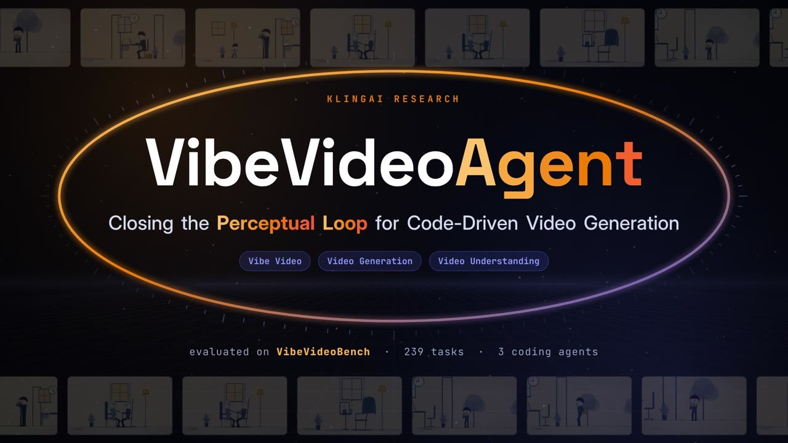

# VibeVideoAgent

**Closing the perceptual loop for code-driven video generation.**

<!-- INTRO VIDEO: after uploading the intro MP4 through GitHub's web editor, replace the <p> block below with the generated https://github.com/user-attachments/assets/... URL on its own line. -->
<p align="center">
  
</p>

VibeVideoAgent gives a coding agent eyes and ears while it writes a video. The agent turns your brief into quoted requirements, renders a small preview, checks what a viewer can actually see or hear, edits its own source, re-checks the same moment on the new render, and verifies the encoded delivery. Claude Code and Codex use the same eleven MCP tools and the same production skill, with no renderer-specific adapters: HTML/Canvas, WebGL/Three.js, React/Remotion, Python (Pillow, Cairo, Manim), SVG and FFmpeg/TTS audio pipelines all work through the same interface.

> 📄 Paper: [*VibeVideoAgent: Closing the Perceptual Loop for Code-Driven Video Generation*](https://arxiv.org/abs/2611.34237) · [Citation](#citation)

## Why

A render script can exit with code 0 and still produce a broken video: a backpack held in the hand instead of worn, a camera orbiting away from the subject, captions colliding, narration two seconds behind the chart it describes. Coding agents get no runtime error for any of these. Pasting raw frames and audio into the coding session fills the context window, and reviewing only the final full render turns early design mistakes into whole-project rewrites.

VibeVideoAgent runs multimodal perception (Gemini) in short-lived calls **outside** the coding context. The agent gets compact, timestamped, box-annotated *Findings* back. Each Finding is tied to the SHA-256 of the media it observed, so a later `compare_media` can confirm that an edit actually fixed the reported problem.

## Results

These are results on all 239 tasks of VibeVideoBench. Each backbone runs in its native CLI (Claude Code for Claude, Codex CLI for GPT-6 Astra) inside identical sandboxes, with Gemini 3.8 Flash as the fixed perception model. Scores are equal-weight averages of the two official judges (Gemini 3.8 Flash and Gemini 4 Argon). L1 is technical-spec compliance (%), L2 is fine-grained rubric pass rate (%), and L3 is five 1–5 perceptual dimensions: visual quality (VQ), visual aesthetics (VA), content logic (CL), timing & motion (TM) and audio quality / A–V sync (AQ).

| Backbone | Configuration | L1 | L2 | VQ | VA | CL | TM | AQ | **L3 Mean** |
| --- | --- | :-: | :-: | :-: | :-: | :-: | :-: | :-: | :-: |
| Claude Opus 5.5 | Native agent | **99.92** | 98.87 | 4.04 | 4.08 | 4.09 | 4.03 | 3.89 | 4.03 |
| | **+ VibeVideoAgent** | 98.59 | **99.35** | **4.37** | **4.43** | **4.46** | **4.42** | **4.45** | **4.43** |
| Claude Sonnet 5.5 | Native agent | **99.18** | **96.36** | 3.97 | 4.02 | 4.03 | 3.96 | 3.85 | 3.97 |
| | **+ VibeVideoAgent** | 95.75 | 94.61 | **3.98** | **4.05** | **4.15** | **4.07** | **4.25** | **4.10** |
| GPT-6 Astra | Native agent | 98.93 | 98.67 | 4.07 | 4.09 | 4.08 | 3.98 | 3.94 | 4.03 |
| | **+ VibeVideoAgent** | **99.51** | **99.15** | **4.26** | **4.31** | **4.29** | **4.20** | **4.26** | **4.27** |

VibeVideoAgent raises every L3 dimension on all three backbones. The largest gain is on audio quality / A–V sync (+0.56 for Opus 5.5). Under the stricter, independent Gemini 4 Argon judge, Opus 5.5 improves L2 by +0.80 pp and L3 by +0.33.

**Component ablations.** These use Claude Opus 5.5 on a 36-task capability-stratified VibeVideoBench subset, selected from native-baseline diagnostics before any variant was run.

| Variant | L1 | L2 | VQ | VA | CL | TM | AQ | **L3 Mean** |
| --- | :-: | :-: | :-: | :-: | :-: | :-: | :-: | :-: |
| Native agent (no perception tools) | **100.00** | 96.06 | 3.87 | 3.90 | 3.89 | 3.76 | 3.80 | 3.84 |
| w/o `check_requirement` | 98.43 | 98.35 | 4.27 | 4.26 | 4.31 | 4.26 | 4.33 | 4.29 |
| w/o `compare_media` | 97.38 | 99.11 | 4.20 | 4.37 | 4.39 | 4.26 | 4.28 | 4.30 |
| w/o `probe_media` | 95.81 | 99.03 | 4.26 | 4.33 | 4.40 | 4.31 | 4.36 | 4.33 |
| Tools only (w/o `plan_production` & preview gate) | 98.95 | 99.03 | 4.26 | 4.27 | 4.43 | 4.29 | 4.34 | 4.32 |
| **VibeVideoAgent (full)** | 98.43 | **99.50** | **4.34** | **4.41** | **4.46** | **4.39** | **4.41** | **4.40** |

## Requirements and platform support

- Python 3.11+.
- FFmpeg and ffprobe on `PATH`, with the libx264, AAC and libopus encoders.
- A Gemini API key and a Gemini model that accepts video, audio and structured output. You only need these for the semantic tools. Planning, `probe_media`, snapshots and delivery checks run offline.
- Claude Code or Codex CLI, or any stdio MCP client.
- The renderer your project uses. See the [rendering guide](src/vibevideo_mcp/skills/vibevideo/references/rendering.md).

| Platform | Status |
| --- | --- |
| Linux | Fully supported. This is the configuration used in the paper. |
| macOS | Supported. Linux-only parent-death supervision of FFmpeg subprocesses is unavailable, so if the client kills the server mid-call, an FFmpeg child may keep running until it finishes. |
| Windows | Not supported. File locking relies on `fcntl`. Use WSL2. |

## Install

Create the virtual environment in a permanent location. The installer records the absolute interpreter path in your project config.

```sh
git clone https://github.com/Kling-Keye/VibeVideoAgent.git && cd VibeVideoAgent
python3 -m venv .venv
. .venv/bin/activate
python -m pip install .
vibevideo doctor          # checks ffmpeg/ffprobe and environment variables, no network access
```

Register the tools in the directory where you will make videos. You can install both clients into the same project.

```sh
vibevideo install claude --project /path/to/my-video
vibevideo install codex  --project /path/to/my-video
```

| Client | Files written in the project |
| --- | --- |
| Claude Code | `.mcp.json`, `.claude/skills/vibevideo/SKILL.md`, `.claude/skills/vibevideo/references/rendering.md` |
| Codex | `.codex/config.toml`, `.agents/skills/vibevideo/SKILL.md`, `.agents/skills/vibevideo/references/rendering.md` |

Reinstalling identical settings is safe, and other MCP servers in the same config are preserved. If the project or interpreter moves, remove the old `vibevideo` entry and rerun the installer. The config stores only environment-variable *names* (Claude Code expands `${GEMINI_API_KEY:-}` at startup), never secret values.

## Make a first video

In the terminal that will launch your client:

```bash
read -rsp 'Gemini API key: ' GEMINI_API_KEY && export GEMINI_API_KEY && printf '\n'
read -rp  'Gemini model ID: ' VIBEVIDEO_GEMINI_MODEL && export VIBEVIDEO_GEMINI_MODEL
cd /path/to/my-video
claude   # or: codex
```

Trust the project and enable the `vibevideo` MCP server when prompted, then try:

> Use the vibevideo skill to make a six-second title card. A blue circle grows into view, pauses, and fades out. Play a short chime at the start of the pause. Give me the final MP4 and the editable source.

The agent will:

1. Call `plan_production` with requirements quoted verbatim from your brief.
2. Render and check the riskiest decision on a small preview (`stage=preview`).
3. Assemble the video, then fix any `fail` verdicts and confirm each fix with `compare_media`.
4. Probe the final encode, snapshot the video, sources and render command, and call `submit_delivery`.

To use a compatible gateway instead of Google's `v1beta` endpoint, set `VIBEVIDEO_GEMINI_BASE_URL` to its versioned base URL. The gateway must support native `generateContent`, the `x-goog-api-key` header, inline media and structured responses. Remote endpoints must use HTTPS.

## The PreToolUse profile (recommended for benchmarking)

### What it does

`--profile PreToolUse` installs a [Claude Code](https://code.claude.com/docs/en/hooks) / [Codex](https://developers.openai.com/codex/hooks/) `PreToolUse` hook that checks every tool call the coding agent makes:

- **Before a plan is active**, the agent may only read the brief and the skill and list inputs. It must call `plan_production` and then `status(task_id)` before it can edit, render or call media tools. This binds the validated plan to the current client session.
- **During production** the hook blocks:
  - direct reads of images, video, audio and PDFs (`Read`, `cat`, `head`, `sed -n`)
  - image-viewing, screenshot and browser tools
  - subagents and other MCP servers
  - edits to `inputs/`, `.vibevideo/`, `.git/`, `.env*` and client config
  - shell commands that call model APIs directly (e.g. `generateContent`, `api.anthropic.com`, `GEMINI_API_KEY`)

  Ordinary shell commands for rendering remain available.

### Why use it

- **It makes the perceptual loop the only way to see media.** Without the hook, an agent can still open frames with its native image reader. That puts raw pixels back into the long coding context, which VibeVideoAgent is designed to avoid, and it bypasses the requirement-bound, hash-tracked Findings.
- **Results are attributable and comparable.** Every observation goes through the seven audited primitives, so improvements can be attributed to the closed loop rather than to ad-hoc VLM calls, extra agents or hidden perception. All `+ VibeVideoAgent` numbers above were collected with this boundary in place.
- **The run is auditable.** Every decision is appended to `.vibevideo/hooks/audit.jsonl` with the tool name, verdict and reason. Command bodies, media and credentials are never logged.

Use it whenever you want to reproduce the paper or compare agents. For everyday creative work, the default (standard) profile is fine and leaves your agent's other tools untouched.

### How to enable it

```sh
vibevideo install claude --project /path/to/my-video --profile PreToolUse
vibevideo install codex  --project /path/to/my-video --profile PreToolUse
```

1. Restart the client in the trusted project.
2. Open `/hooks` and confirm **PreToolUse** is enabled. Claude Code reads `.claude/settings.json` and Codex reads `.codex/hooks.json`.
3. In Codex, trust the exact hook definition before the first run, and trust it again whenever its command changes.
4. The installer refuses to proceed if hooks are explicitly disabled in the project config.

To remove the hook, rerun the installer with `--profile standard` and restart the client. Omitting `--profile` keeps the current setting. Your other hooks are never modified.

> [!NOTE]
> The hook enforces rules at tool entry. Filesystem isolation, CPU/memory limits and network policy are the host's responsibility. In the paper, each run additionally used an isolated 16-vCPU Linux namespace with read-only task inputs.

## Tools

The seven perception primitives from the paper, plus four production tools:

| Tool | Role | Use during production |
| --- | --- | --- |
| `plan_production` | protocol | Start a task with the original brief, verbatim-quoted requirements, ordered beats and a representative preview. Returns a task ID. |
| `describe_media` | explore | Index the sampled scenes, layout and sounds of unfamiliar inputs. |
| `locate_event` | explore | Search for an event and optionally refine up to two candidate windows at 8 fps. |
| `inspect_segment` | explore | Inspect an interval or pixel crop and optionally return actual evidence frames. |
| `transcribe_speech` | explore | Extract audio and transcribe spoken lines with excerpt-local and source times. |
| `check_requirement` | verify | Check one planned requirement against a preview, assembly or final encode. Missing modalities yield `uncertain`. |
| `compare_media` | verify | Compare to a reference, or re-check a prior Finding on a new render (dual-clock; `resolved` / `persists` / …). |
| `probe_media` | signal | Run local checks with no API call: streams, full decode, repeated frames, endpoint seams, LUFS loudness, silence. |
| `register_artifact` | delivery | Snapshot the encoded video, the listed editable files and the replayable render argv. |
| `submit_delivery` | delivery | Decode the snapshot, enforce requested specs and report the evidence tied to its hash. |
| `status` | protocol | List tasks, or pass a task ID to recover the plan, Findings and latest delivery (and activate it under PreToolUse). |

Conventions:

- Media paths are relative to the workspace.
- The `crop` input uses source pixels `[x, y, width, height]`. Returned evidence boxes use normalized excerpt coordinates `[left, top, right, bottom]`.
- Times refer to the source file. Set `timeline_offset` when source time zero maps to a different edit time.
- A successful submission means the encoded file met the declared technical constraints. Its verification record lists the sampled evidence for each creative requirement separately.

## Project files, budgets and privacy

- Each task owns `.vibevideo/runs/<task_id>/`. This holds the saved plan, sampled excerpts, Findings, revision links and immutable artifact snapshots. Add `.vibevideo/` to your project's `.gitignore`. Call `status` to resume after a restart.
- **Default budget per task:** 40 semantic calls, 8,192 sampled frames and 7,200 s of audio. Each excerpt samples at most 256 frames at up to 16 fps. Cache hits reuse matching evidence and cost nothing. There is no wall-clock deadline.
- **What leaves your machine:** only the excerpt (clip, still or audio) the agent selects for a semantic tool call, plus the inspection question, sent to the configured Gemini endpoint. Full source files, your code and your credentials are never uploaded. The server refuses paths outside the workspace and private paths such as `.env*`, `.ssh`, `.git` and client config.

## Other MCP clients

Configure a stdio server that runs `vibevideo serve --workspace /absolute/path/to/my-video`, and forward `GEMINI_API_KEY`, `VIBEVIDEO_GEMINI_MODEL` and, optionally, `VIBEVIDEO_GEMINI_BASE_URL`. The workflow instructions are bundled at [`src/vibevideo_mcp/skills/vibevideo/SKILL.md`](src/vibevideo_mcp/skills/vibevideo/SKILL.md).

## Tests

```sh
python -m unittest discover -s tests -v
```

The suite generates small synthetic clips with FFmpeg and exercises the real MCP stdio protocol and the PreToolUse hook against a loopback-only Gemini fixture. It needs no API key and no paid model session.

## Citation

```bibtex
@misc{zheng2026vibevideoagentclosingperceptualloop,
      title={VibeVideoAgent: Closing the Perceptual Loop for Code-Driven Video Generation}, 
      author={Xuanyu Zheng and Luoyuan Zhang and Yancheng Long and Haoyang Xu and Muxi Diao and Yuzhe Chen and Kaiyu Jiang and Bin Wen and Tingting Gao},
      year={2026},
      eprint={2611.34237},
      archivePrefix={arXiv},
      primaryClass={cs.CV},
      url={https://arxiv.org/abs/2611.34237}, 
}
```

## License

MIT. See [LICENSE](LICENSE).
